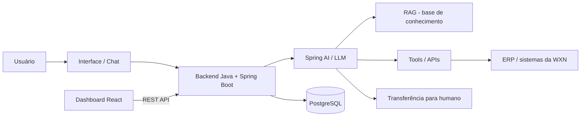

# WXN Chatbot

Fundação técnica do projeto de atendimento automatizado (chatbot / agente de
IA) para a **WXN Tecnologia** — Projeto 3, Computação, CESAR School.

> **Situação atual (22/10/2026):** o ambiente de desenvolvimento e de deploy
> está pronto e o backend já tem o modelo de dados, a fila de conversas, o
> classificador de urgência, o mock da API da WXN e as ferramentas do chatbot.
> O que ainda **não existe** é o fluxo de conversa de ponta a ponta (endpoint
> de mensagens e orquestrador), a integração com a LLM e as telas do chat e do
> dashboard. Veja [Próximos passos](#próximos-passos).

## Sobre o projeto

A WXN Tecnologia é uma software house que atende empresas com soluções SaaS
integradas a ERPs. O desafio proposto ao grupo é criar uma solução de
atendimento automatizado capaz de conversar com usuários, responder dúvidas,
consultar sistemas, manter contexto, transferir casos complexos para um
atendente humano e expor tudo isso em um dashboard para gestores e
atendentes.

Este repositório é o **monorepo** do projeto: backend, frontend e
documentação técnica vivem juntos aqui.

## Arquitetura

Visão de longo prazo do sistema (a maior parte ainda não implementada):



O que **já existe** de ponta a ponta é o caminho `Dashboard React → REST API
→ Spring Boot → PostgreSQL` reduzido ao mínimo: o frontend chama
`GET /api/health` e o backend responde. No backend também já existem o modelo
persistido no PostgreSQL, a fila de conversas, o classificador de urgência e
as ferramentas do chatbot, que consultam a API da WXN (hoje um mock). Ainda
são só arquitetura planejada a LLM (`AI`), o `RAG` e as telas do chat e do
dashboard.

## Tecnologias

| Camada | Tecnologia | Observação |
|---|---|---|
| Backend | Java 21 (LTS) + Spring Boot 4.1 + Maven | Gerado a partir do Spring Initializr oficial em 31/08/2026 |
| Frontend | React 19 + TypeScript + Vite | `npm create vite@latest -- --template react-ts` |
| Banco de dados | PostgreSQL | Local em dev; [Neon](https://neon.com/) recomendado para a nuvem — ver `docs/deploy.md` |
| Versionamento | Git + GitHub | Monorepo, fluxo `feature/* → develop → main` |

Versões exatas ficam fixadas em `backend/pom.xml` (Spring Boot, via o
`spring-boot-starter-parent`) e `frontend/package.json` (React, Vite,
TypeScript) — consulte esses arquivos para os números precisos a qualquer
momento, em vez de confiar só nesta tabela.

Fora de escopo por enquanto: Docker, Kubernetes, microsserviços,
Redis/Kafka/RabbitMQ e autenticação. A parte de IA (Spring AI, RAG, MCP) ainda
não foi implementada: as ferramentas do chatbot existem, mas nenhuma LLM as
chama ainda. Ver [Próximos passos](#próximos-passos).

## Pré-requisitos

Instale na sua máquina, na ordem:

1. **Git** — [git-scm.com](https://git-scm.com/downloads)
2. **JDK 21 (LTS)** — o Spring Boot 4.1 aceita a partir do Java 17, mas o
   grupo padronizou em 21 por ser a LTS mais estável e mais disponível hoje.
   - Windows: instale o **Eclipse Temurin 21** (`.msi`) em
     [adoptium.net](https://adoptium.net/temurin/releases/?version=21) —
     marque a opção "Set JAVA_HOME" durante a instalação.
   - macOS/Linux: `sdk install java 21-tem` (via [SDKMAN!](https://sdkman.io/)) ou o pacote equivalente da sua distro.
   - Confirme com `java -version` — precisa mostrar `21` (ou maior). **Não
     use o Java 8**, mesmo que já esteja instalado por outro motivo na sua
     máquina — o Spring Boot 4 não sobe nele.
3. **Node.js 24 (LTS)** — [nodejs.org](https://nodejs.org/) (instala `npm`
   junto). Confirme com `node -v` e `npm -v`.
4. **PostgreSQL 16+** — [postgresql.org/download](https://www.postgresql.org/download/)
   (no Windows, o instalador já inclui o **pgAdmin**, uma interface gráfica
   opcional, e o **SQL Shell (psql)**, o terminal do banco).
5. **Maven não precisa ser instalado** — o backend usa o *Maven Wrapper*
   (`mvnw` / `mvnw.cmd`), que baixa a versão certa automaticamente.

### IDE

O projeto não depende de nenhuma IDE específica. O grupo usa **VS Code**
e/ou **Eclipse** — os dois funcionam sem ajuste nenhum:

- **VS Code:** abra a pasta raiz do repositório. Para o backend, instale a
  extensão *Extension Pack for Java* (inclui suporte a Maven); para o
  frontend, as extensões padrão de TypeScript/ES já bastam.
- **Eclipse:** se for usar Eclipse pro backend, use o **Spring Tool Suite
  (STS)** — é o Eclipse com suporte a Spring Boot já embutido (Spring Boot
  Dashboard, wizards, etc.), recomendação do professor pra evitar conflito
  de configuração entre quem usa VS Code e quem usa Eclipse no mesmo
  projeto. Baixe em [spring.io/tools](https://spring.io/tools), depois
  `File → Import… → Maven → Existing Maven Projects`, apontando para a
  pasta `backend/` (o `pom.xml` é reconhecido automaticamente via m2e). O
  frontend não é aberto no Eclipse/STS — use VS Code (ou outro editor de
  sua preferência) para a pasta `frontend/`.

## Configuração do banco

1. Abra o **SQL Shell (psql)** (Windows) ou `psql` no terminal (macOS/Linux)
   como usuário administrador do Postgres (`postgres`).
2. Crie o usuário e o banco usados pelo backend (nomes combinados com os
   defaults do `application.properties` — ver [Variáveis de ambiente](#variáveis-de-ambiente)):

   ```sql
   CREATE USER wxn_user WITH PASSWORD 'wxn_password';
   CREATE DATABASE wxn_chatbot OWNER wxn_user;
   ```

3. Teste a conexão:

   ```bash
   psql -h localhost -U wxn_user -d wxn_chatbot
   ```

   Se pedir a senha e conectar sem erro, está pronto — pode sair com `\q`.
   O banco começa vazio: as tabelas são criadas pelo Hibernate, a partir das
   entidades JPA, na primeira vez que o backend subir (`ddl-auto=update`).
   Ainda não há migrations versionadas.

Prefere GUI? O **pgAdmin** faz os mesmos dois passos (criar login role +
criar database) pela interface gráfica, se preferir não usar o terminal.

> `pgvector` **não** é necessário nesta etapa. Ele entra futuramente, só
> quando (e se) a etapa de RAG for implementada.

## Executando o backend

```bash
cd backend
./mvnw spring-boot:run
```

No Windows (cmd/PowerShell), use `mvnw.cmd spring-boot:run` em vez de
`./mvnw spring-boot:run`.

Se o Postgres do passo anterior estiver rodando e acessível, o backend sobe
em `http://localhost:8080`. Teste:

```bash
curl http://localhost:8080/api/health
# {"status":"ok"}
```

Se a resposta acima aparecer, o backend está de pé **e** conectado ao banco
(se a conexão falhasse, o Spring Boot não conseguiria terminar de subir).

### API simulada da WXN

As ferramentas do chatbot consultam a API de demandas da WXN, que ainda não
existe. Para desenvolver, suba o backend com o perfil `mock`, que expõe uma
versão simulada, com dados fictícios, em `/mock/wxn`:

```bash
SPRING_PROFILES_ACTIVE=mock ./mvnw spring-boot:run
```

No PowerShell: `$env:SPRING_PROFILES_ACTIVE="mock"; ./mvnw spring-boot:run`.
Dados, protocolos de teste e como usar as ferramentas estão em
[`docs/integracao-wxn.md`](docs/integracao-wxn.md).

### Testes

```bash
cd backend
./mvnw -Dtest='!BackendApplicationTests' -Dsurefire.failIfNoSpecifiedTests=false test
```

Esse comando roda os testes que não precisam de banco. O
`BackendApplicationTests` sobe o contexto do Spring e exige o PostgreSQL local
do passo anterior; `./mvnw verify` roda tudo. O CI executa isso em todo pull
request para `develop` e `main`, com um Postgres de teste.

## Executando o frontend

Em outro terminal:

```bash
cd frontend
npm install
npm run dev
```

Abra `http://localhost:5173`. A página mostra "Backend conectado" se o
backend (passo anterior) estiver rodando, ou "Backend indisponível" caso
contrário — é só isso que esta página faz por enquanto.

## Variáveis de ambiente

Veja `.env.example` (raiz) e `frontend/.env.example`. Resumo:

| Variável | Onde é usada | Default em dev |
|---|---|---|
| `DB_URL`, `DB_USER`, `DB_PASSWORD` | Backend (`application.properties`) | já apontam para o banco local descrito acima — **não precisa configurar nada para rodar localmente** |
| `SERVER_PORT` | Backend | `8080` |
| `CORS_ALLOWED_ORIGINS` | Backend | `http://localhost:5173` |
| `SPRING_PROFILES_ACTIVE` | Backend | vazio; use `mock` para a API simulada da WXN |
| `WXN_API_BASE_URL` | Backend | `http://localhost:8080/mock/wxn` (o mock do próprio backend) |
| `VITE_API_URL` | Frontend (`frontend/.env`, se você criar um) | `http://localhost:8080` |
| `OPENAI_API_KEY` / `ANTHROPIC_API_KEY` | Reservado para etapas futuras | vazio — **não preencher com chave real neste repositório** |

Nenhuma senha ou chave real está (nem deve estar) commitada. Os valores
acima em `DB_*` são credenciais de desenvolvimento local, não segredos de
produção — em produção elas são configuradas como variáveis de ambiente
reais na plataforma de deploy (ver `docs/deploy.md`).

## Estrutura do projeto

```
WXN-G16/
├── .github/workflows/       CI dos pull requests (ci.yml) e deploys (só na main)
├── backend/                 Spring Boot (Java 21, Maven)
│   ├── src/main/java/br/com/wxnchatbot/backend/
│   │   ├── config/          CorsConfig
│   │   ├── controller/      HealthController (GET /api/health)
│   │   ├── ferramenta/      Ferramentas do chatbot (consultar demanda, abrir chamado)
│   │   ├── integracao/wxn/  Gateway da API da WXN e o mock (perfil `mock`)
│   │   ├── model/           Entidades JPA do domínio (Conversa, Mensagem…)
│   │   ├── notificacao/     NotificationGateway (e-mail) e implementação fake
│   │   ├── repository/      Repositórios Spring Data (Conversa, Atendente)
│   │   ├── service/         Fila de conversas e classificador de urgência
│   │   └── BackendApplication.java
│   ├── src/test/java/…      Testes (JUnit)
│   └── src/main/resources/application.properties
├── frontend/                 React + TypeScript (Vite)
│   └── src/
│       ├── components/      StatusBadge
│       ├── pages/            Dashboard
│       ├── services/         api.ts (chamadas HTTP ao backend)
│       ├── hooks/             useBackendHealth
│       └── types/             HealthResponse
├── docs/
│   ├── api/                   Contratos OpenAPI (wxn-demandas.openapi.yaml)
│   ├── backlog-implementacao.md  Divisão em 8 vagas, tarefas por sprint e escolha da LLM
│   ├── integracao-wxn.md      API simulada da WXN, ferramentas do chatbot e e-mail
│   ├── modelagem-inicial.md  Entidades futuras (Company, User, Conversation…)
│   ├── modelo-de-classes.md  Diagrama de classes e decisões de POO (Semana 11)
│   ├── deploy.md              Pesquisa de hospedagem (Azure Free + Neon)
│   ├── entrega-semana-05.md   Texto da entrega acadêmica da Semana 05
│   ├── entrega-semana-11.md   Texto da entrega acadêmica da Semana 11
│   ├── escopo-chatbot.md      Canal (WhatsApp), acesso a dados do cliente,
│   │                           glossário técnico e priorização (MoSCoW)
│   └── status-e-roadmap.md    Diagnóstico do projeto, riscos, escopo do
│                               PoC do SR2 e roadmap até lá
├── .env.example
├── .gitignore
└── README.md
```

Pastas só são criadas quando têm conteúdo: `dto/` e `exception/`, por
exemplo, ainda não existem. O pacote `model/` guarda as entidades JPA e as
regras do domínio; ver [`docs/modelo-de-classes.md`](docs/modelo-de-classes.md).

## Git workflow

Três tipos de branch:

- **`main`** — sempre estável.
- **`develop`** — branch de integração do grupo.
- **`feature/nome-da-feature`** — uma por funcionalidade, a partir de
  `develop`, mesclada de volta nela quando pronta.

```
feature/*  →  develop  →  main
```

Fluxo do dia a dia:

```bash
git checkout develop
git pull
git checkout -b feature/o-que-voce-vai-fazer
# ... commits ...
git push -u origin feature/o-que-voce-vai-fazer
# abrir Pull Request para develop no GitHub
```

Ao abrir o Pull Request, escolha **`develop`** como branch de destino (o
GitHub sugere `main` por padrão). O CI roda nos PRs para `develop` e `main`.
As histórias e as tarefas ficam no board [WXN Grupo 16](https://github.com/orgs/CC-2025-2-CESAR/projects/3).

`main` só recebe merge de `develop` quando o grupo considerar aquele estado
pronto para ser uma versão estável (ex.: antes de uma entrega).

## Deploy

**No ar** desde 03/09/2026 — **Azure App Service (F1, free)** para o
backend, **Azure Static Web Apps (free)** para o frontend (planos que não
consomem os créditos do Azure for Students do grupo), e **Neon** para o
PostgreSQL (plano free sem prazo de expiração, fora do Azure porque o
Postgres do Azure não tem tier gratuito):

- Frontend: <https://happy-desert-0e6abd410.5.azurestaticapps.net>
- Backend: <https://wxn-g16-backend.azurewebsites.net/api/health>

O backend builda e publica automaticamente via GitHub Actions a cada push na
`main` que altere `backend/`
([`.github/workflows/deploy-backend.yml`](.github/workflows/deploy-backend.yml));
o frontend segue a mesma regra para `frontend/`. Detalhes, decisões e como
reproduzir em [`docs/deploy.md`](docs/deploy.md).

## Próximos passos

O plano completo (tarefas por pessoa, sprints e a escolha da LLM) está em
[`docs/backlog-implementacao.md`](docs/backlog-implementacao.md). O que falta,
nesta ordem aproximada:

1. **Migrations** — adotar o Flyway e trocar `ddl-auto` para `validate`; criar
   a `Empresa`, para isolar os dados por empresa.
2. **Fluxo de conversa** — endpoint de mensagens, histórico persistido e o
   orquestrador que decide entre consultar a WXN, encaminhar a um humano ou
   responder.
3. **LLM** — integração com o Spring AI (a recomendação é o plano gratuito da
   Gemini, com a Groq de reserva), prompt da Lily e filtros de entrada e saída.
4. **Frontend** — simulador de chat e dashboard de atendimento (fila de
   conversas, assumir caso, métricas).
5. **Autenticação** mínima nas rotas do painel.
6. **Depois da PoC** — RAG (base de conhecimento), MCP, e-mail de confirmação
   com SMTP real e o canal real do WhatsApp.
