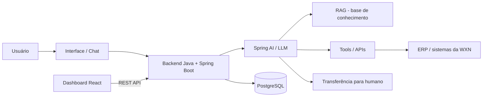

# WXN Chatbot

Fundação técnica do projeto de atendimento automatizado (chatbot / agente de
IA) para a **WXN Tecnologia** — Projeto 3, Computação, CESAR School.

> **Situação atual (05/11/2026):** o ambiente de desenvolvimento e de deploy
> está pronto e **no ar no Azure**. O backend já tem o modelo de dados com
> migrations (Flyway), a fila de conversas com a API REST dela, o
> classificador de urgência, o `TicketServico` (abre o ticket com urgência e
> resumo, ainda sem endpoint), o mock da API da WXN, as ferramentas do chatbot
> e um orquestrador de conversa que ainda usa uma LLM fake. O frontend já tem
> o dashboard de atendimento (fila, assumir e encerrar). A Gemini já foi
> testada isoladamente e funcionou, mas ainda não está ligada ao backend. O que
> ainda **não existe** é o endpoint de mensagens do chat, a integração com a
> LLM de verdade e a tela do chat. Veja [Próximos passos](#próximos-passos).

## Sobre o projeto

A WXN Tecnologia é uma software house que atende empresas com soluções SaaS
integradas a ERPs. O desafio proposto ao grupo é criar uma solução de
atendimento automatizado capaz de conversar com usuários, responder dúvidas,
consultar sistemas, manter contexto, transferir casos complexos para um
atendente humano e expor tudo isso em um dashboard para gestores e
atendentes.

Este repositório é o **monorepo** do projeto: backend, frontend e
documentação técnica vivem juntos aqui.

## Arquitetura

Visão de longo prazo do sistema (a maior parte ainda não implementada):



O que **já existe** de ponta a ponta, inclusive no ar no Azure, é o caminho
`Dashboard React → REST API → Spring Boot → PostgreSQL`: o dashboard lista a
fila de conversas que aguardam um atendente, abre cada uma, assume e encerra
(ver [`docs/ui-fila-atendimento.md`](docs/ui-fila-atendimento.md)). No backend
também já existem o orquestrador do turno da conversa (com uma LLM fake), o
classificador de urgência e as ferramentas do chatbot, que consultam a API da
WXN (hoje um mock). Ainda são só arquitetura planejada a LLM de verdade
(`AI`), o `RAG` e a tela do chat.

## Tecnologias

| Camada | Tecnologia | Observação |
|---|---|---|
| Backend | Java 21 (LTS) + Spring Boot 4.1 + Maven | Gerado a partir do Spring Initializr oficial em 31/08/2026 |
| Frontend | React 19 + TypeScript + Vite | `npm create vite@latest -- --template react-ts` |
| Banco de dados | PostgreSQL | Local em dev; [Neon](https://neon.com/) na nuvem — ver `docs/deploy.md` |
| Migrations | Flyway | As tabelas vêm de `backend/src/main/resources/db/migration`; o Hibernate só valida |
| Versionamento e CI | Git + GitHub + GitHub Actions | Monorepo, fluxo `feature/* → develop → main`; testes e build em todo PR |

Versões exatas ficam fixadas em `backend/pom.xml` (Spring Boot, via o
`spring-boot-starter-parent`) e `frontend/package.json` (React, Vite,
TypeScript) — consulte esses arquivos para os números precisos a qualquer
momento, em vez de confiar só nesta tabela.

Fora de escopo por enquanto: Kubernetes, microsserviços, Redis/Kafka/RabbitMQ
e autenticação. O Docker só deve entrar nos testes de integração, via
Testcontainers (a dependência já está no `pom.xml`, mas os testes ainda usam o
Postgres do CI). A parte de IA (Spring AI, RAG, MCP) ainda não foi
implementada no backend: as ferramentas do chatbot existem, mas nenhuma LLM as
chama ainda; a Gemini só foi medida num experimento isolado
([`docs/spike-llm.md`](docs/spike-llm.md)). Ver
[Próximos passos](#próximos-passos).

## Pré-requisitos

Instale na sua máquina, na ordem:

1. **Git** — [git-scm.com](https://git-scm.com/downloads)
2. **JDK 21 (LTS)** — o Spring Boot 4.1 aceita a partir do Java 17, mas o
   grupo padronizou em 21 por ser a LTS mais estável e mais disponível hoje.
   - Windows: instale o **Eclipse Temurin 21** (`.msi`) em
     [adoptium.net](https://adoptium.net/temurin/releases/?version=21) —
     marque a opção "Set JAVA_HOME" durante a instalação.
   - macOS/Linux: `sdk install java 21-tem` (via [SDKMAN!](https://sdkman.io/)) ou o pacote equivalente da sua distro.
   - Confirme com `java -version` — precisa mostrar `21` (ou maior). **Não
     use o Java 8**, mesmo que já esteja instalado por outro motivo na sua
     máquina — o Spring Boot 4 não sobe nele.
3. **Node.js 24 (LTS)** — [nodejs.org](https://nodejs.org/) (instala `npm`
   junto). Confirme com `node -v` e `npm -v`.
4. **PostgreSQL 16+** — [postgresql.org/download](https://www.postgresql.org/download/)
   (no Windows, o instalador já inclui o **pgAdmin**, uma interface gráfica
   opcional, e o **SQL Shell (psql)**, o terminal do banco).
5. **Maven não precisa ser instalado** — o backend usa o *Maven Wrapper*
   (`mvnw` / `mvnw.cmd`), que baixa a versão certa automaticamente.

### IDE

O projeto não depende de nenhuma IDE específica. O grupo usa **VS Code**
e/ou **Eclipse** — os dois funcionam sem ajuste nenhum:

- **VS Code:** abra a pasta raiz do repositório. Para o backend, instale a
  extensão *Extension Pack for Java* (inclui suporte a Maven); para o
  frontend, as extensões padrão de TypeScript/ES já bastam.
- **Eclipse:** se for usar Eclipse pro backend, use o **Spring Tool Suite
  (STS)** — é o Eclipse com suporte a Spring Boot já embutido (Spring Boot
  Dashboard, wizards, etc.), recomendação do professor pra evitar conflito
  de configuração entre quem usa VS Code e quem usa Eclipse no mesmo
  projeto. Baixe em [spring.io/tools](https://spring.io/tools), depois
  `File → Import… → Maven → Existing Maven Projects`, apontando para a
  pasta `backend/` (o `pom.xml` é reconhecido automaticamente via m2e). O
  frontend não é aberto no Eclipse/STS — use VS Code (ou outro editor de
  sua preferência) para a pasta `frontend/`.

## Configuração do banco

1. Abra o **SQL Shell (psql)** (Windows) ou `psql` no terminal (macOS/Linux)
   como usuário administrador do Postgres (`postgres`).
2. Crie o usuário e o banco usados pelo backend (nomes combinados com os
   defaults do `application.properties` — ver [Variáveis de ambiente](#variáveis-de-ambiente)):

   ```sql
   CREATE USER wxn_user WITH PASSWORD 'wxn_password';
   CREATE DATABASE wxn_chatbot OWNER wxn_user;
   ```

3. Teste a conexão:

   ```bash
   psql -h localhost -U wxn_user -d wxn_chatbot
   ```

   Se pedir a senha e conectar sem erro, está pronto — pode sair com `\q`.
   O banco começa vazio: as tabelas são criadas pelo Flyway, a partir das
   migrations em `backend/src/main/resources/db/migration`, na primeira vez
   que o backend subir. O Hibernate só confere se as entidades JPA batem com
   elas (`ddl-auto=validate`).

Prefere GUI? O **pgAdmin** faz os mesmos dois passos (criar login role +
criar database) pela interface gráfica, se preferir não usar o terminal.

> `pgvector` **não** é necessário nesta etapa. Ele entra futuramente, só
> quando (e se) a etapa de RAG for implementada.

## Executando o backend

```bash
cd backend
./mvnw spring-boot:run
```

No Windows (cmd/PowerShell), use `mvnw.cmd spring-boot:run` em vez de
`./mvnw spring-boot:run`.

Se o Postgres do passo anterior estiver rodando e acessível, o backend sobe
em `http://localhost:8080`. Teste:

```bash
curl http://localhost:8080/api/health
# {"status":"ok"}
```

Se a resposta acima aparecer, o endpoint da API está de pé. Para conferir se
a aplicação está pronta e consegue acessar o banco, consulte
`http://localhost:8080/actuator/health/readiness`.

### API simulada da WXN

As ferramentas do chatbot consultam a API de demandas da WXN, que ainda não
existe. O perfil `dev` é o padrão e inclui automaticamente o perfil `mock`,
que expõe uma versão simulada, com dados fictícios, em `/mock/wxn`. Para
executar explicitamente:

```bash
SPRING_PROFILES_ACTIVE=dev ./mvnw spring-boot:run
```

No PowerShell:

```powershell
$env:SPRING_PROFILES_ACTIVE="dev"
./mvnw spring-boot:run
```

Dados, protocolos de teste e como usar as ferramentas estão em
[`docs/integracao-wxn.md`](docs/integracao-wxn.md).

### Dados de demonstração

Para ver a fila de atendimento com conversas de exemplo, suba o backend com o
perfil `demo`, que cria dados fictícios uma única vez:

```bash
./mvnw spring-boot:run -Dspring-boot.run.profiles=demo
```

No PowerShell: `./mvnw.cmd spring-boot:run "-Dspring-boot.run.profiles=demo"`.
O que é criado e como usar a tela estão em
[`docs/ui-fila-atendimento.md`](docs/ui-fila-atendimento.md).

No Azure a fila só aparece preenchida se o App Service rodar com
`SPRING_PROFILES_ACTIVE=prod,demo`. O `demo` liga junto o `dev` e o `mock`
(o `/mock/wxn` passa a responder e o log mostra o SQL), então use só em
apresentações e volte para `prod` depois. As conversas criadas ficam no banco e
não são recriadas (o perfil só cria os dados se eles ainda não existirem).

### Testes

```bash
cd backend
./mvnw -Dtest='!BackendApplicationTests,!*IntegracaoTest' -Dsurefire.failIfNoSpecifiedTests=false test
```

Esse comando roda os testes que não precisam de banco. O
`BackendApplicationTests` e os `*IntegracaoTest` sobem o contexto do Spring e
exigem o PostgreSQL local do passo anterior; `./mvnw verify` roda tudo. O CI
executa isso em todo pull request para `develop` e `main`, com um Postgres de
teste.

## Executando o frontend

Em outro terminal:

```bash
cd frontend
npm install
npm run dev
```

Abra `http://localhost:5173`. O dashboard mostra a fila de conversas que
aguardam um atendente e deixa abrir, assumir e encerrar cada uma, com o
backend (passo anterior) rodando; com o perfil `demo` há conversas de
exemplo. A lateral indica "Backend conectado" ou "Backend indisponível".

## Variáveis de ambiente

Veja `.env.example` (raiz) e `frontend/.env.example`. Resumo:

| Variável | Onde é usada | Default em dev |
|---|---|---|
| `DB_URL`, `DB_USER`, `DB_PASSWORD` | Backend (`application-dev.properties` / `application-prod.properties`) | defaults locais em `dev`; obrigatórias em `prod` |
| `SERVER_PORT` | Backend | `8080` |
| `CORS_ALLOWED_ORIGINS` | Backend | `http://localhost:5173` |
| `SPRING_PROFILES_ACTIVE` | Backend | `dev` por padrão (inclui o mock); `demo` (inclui o `dev`) para os dados de demonstração; use `prod` no deploy |
| `WXN_API_BASE_URL` | Backend | URL do mock em `dev`; URL da API configurada em `prod` |
| Readiness | Backend (Actuator) | `GET /actuator/health/readiness`, inclui verificação do banco |
| `VITE_API_URL` | Frontend (`frontend/.env`, se você criar um) | `http://localhost:8080` |
| `OPENAI_API_KEY` / `ANTHROPIC_API_KEY` | Reservado para etapas futuras | vazio — **não preencher com chave real neste repositório** |

Nenhuma senha ou chave real está (nem deve estar) commitada. Os valores
acima em `DB_*` são credenciais de desenvolvimento local, não segredos de
produção — em produção elas são configuradas como variáveis de ambiente
reais na plataforma de deploy (ver `docs/deploy.md`).

## Estrutura do projeto

```
WXN-G16/
├── .github/workflows/       CI dos PRs (ci.yml), guarda de origem para a main e deploys (só na main)
├── backend/                 Spring Boot (Java 21, Maven)
│   ├── src/main/java/br/com/wxnchatbot/backend/
│   │   ├── config/          CorsConfig
│   │   ├── controller/      API REST (health, fila, conversas, atendentes) e TratadorDeErros
│   │   ├── demonstracao/    Dados fictícios do perfil `demo`
│   │   ├── ferramenta/      Ferramentas do chatbot (consultar demanda, abrir chamado)
│   │   ├── integracao/wxn/  Gateway da API da WXN e o mock (perfil `mock`)
│   │   ├── llm/             LlmClient (por ora só o fake) e o prompt da Lily
│   │   ├── model/           Entidades JPA do domínio (Conversa, Mensagem…)
│   │   ├── notificacao/     NotificationGateway (e-mail) e implementação fake
│   │   ├── repository/      Repositórios Spring Data (Conversa, Atendente)
│   │   ├── service/         Fila de conversas, atendentes, classificador de urgência, tickets e orquestrador
│   │   └── BackendApplication.java
│   ├── src/test/java/…      Testes (JUnit)
│   └── src/main/resources/  application.properties e db/migration (Flyway)
├── experimentos/gemini/     Teste isolado da Gemini (T3.1.4); ver o LEIA-ME da pasta
├── frontend/                 React + TypeScript (Vite)
│   └── src/
│       ├── components/      StatusBadge
│       ├── dashboard/        Tela da fila de atendimento
│       ├── services/         api.ts (chamadas HTTP ao backend)
│       ├── hooks/             Fila, detalhe da conversa, atendentes e status do backend
│       └── types/             Tipos da API (fila, health)
├── docs/
│   ├── api/                   Contratos OpenAPI (wxn-demandas, fila-conversas)
│   ├── backlog-implementacao.md  Divisão em 8 vagas, tarefas por sprint e escolha da LLM
│   ├── integracao-wxn.md      API simulada da WXN, ferramentas do chatbot e e-mail
│   ├── modelagem-inicial.md  Entidades futuras (Company, User, Conversation…)
│   ├── modelo-de-classes.md  Diagrama de classes e decisões de POO (Semana 11)
│   ├── deploy.md              Hospedagem (Azure Free + Neon), configuração de produção,
│   │                           reset do banco e o que fazer quando o site cai
│   ├── entrega-semana-05.md   Texto da entrega acadêmica da Semana 05
│   ├── entrega-semana-11.md   Texto da entrega acadêmica da Semana 11
│   ├── escopo-chatbot.md      Canal (WhatsApp), acesso a dados do cliente,
│   │                           glossário técnico e priorização (MoSCoW)
│   ├── spike-llm.md           Limites, tool calling e latência da Gemini (plano grátis)
│   ├── ui-fila-atendimento.md  Tela da fila: como subir com dados de demonstração
│   └── status-e-roadmap.md    Diagnóstico do projeto, riscos, escopo do
│                               PoC do SR2 e roadmap até lá
├── .env.example
├── .gitignore
└── README.md
```

Pastas só são criadas quando têm conteúdo: `dto/` e `exception/`, por
exemplo, ainda não existem. O pacote `model/` guarda as entidades JPA e as
regras do domínio; ver [`docs/modelo-de-classes.md`](docs/modelo-de-classes.md).

## Git workflow

Três tipos de branch:

- **`main`** — sempre estável.
- **`develop`** — branch de integração do grupo.
- **`feature/nome-da-feature`** — uma por funcionalidade, a partir de
  `develop`, mesclada de volta nela quando pronta.

```
feature/*  →  develop  →  main
```

Fluxo do dia a dia:

```bash
git checkout develop
git pull
git checkout -b feature/o-que-voce-vai-fazer
# ... commits ...
git push -u origin feature/o-que-voce-vai-fazer
# abrir Pull Request para develop no GitHub
```

Ao abrir o Pull Request, escolha **`develop`** como branch de destino (o
GitHub sugere `main` por padrão). O CI roda nos PRs para `develop` e `main`.
As histórias e as tarefas ficam no board [WXN Grupo 16](https://github.com/orgs/CC-2025-2-CESAR/projects/3).

`main` só recebe merge de `develop` quando o grupo considerar aquele estado
pronto para ser uma versão estável (ex.: antes de uma entrega). Cada merge na
`main` que mexe em `backend/` ou `frontend/` **publica em produção**.

`main` e `develop` são protegidas: só mudam por pull request, com o CI verde
(testes do backend e lint, tipos e build do frontend). Para a `main`, só vale
PR vindo da `develop`: o check "Origem do PR para a main" reprova qualquer
outra origem. Ao promover a `develop` para a `main`, mescle com **"Create a
merge commit"** (não use squash nem rebase), para as duas branches não
divergirem. Se uma migration nova entrar, confira antes se ela combina com o
que já está aplicado no banco de produção (ver `docs/deploy.md`).

## Deploy

**No ar** desde 03/09/2026 — **Azure App Service (F1, free)** para o
backend, **Azure Static Web Apps (free)** para o frontend (planos que não
consomem os créditos do Azure for Students do grupo), e **Neon** para o
PostgreSQL (plano free sem prazo de expiração, fora do Azure porque o
Postgres do Azure não tem tier gratuito):

- Frontend: <https://happy-desert-0e6abd410.5.azurestaticapps.net>
- Backend: <https://wxn-g16-backend.azurewebsites.net/api/health>

O backend builda e publica automaticamente via GitHub Actions a cada push na
`main` que altere `backend/`
([`.github/workflows/deploy-backend.yml`](.github/workflows/deploy-backend.yml));
o frontend segue a mesma regra para `frontend/`. O deploy do backend só roda a
partir da `main` e termina vermelho se o `/api/health` não responder depois de
publicar. Em produção o backend usa `SPRING_PROFILES_ACTIVE=prod` e o endereço
direto do Neon, sem `-pooler`. Detalhes, decisões, configuração e como
reproduzir em [`docs/deploy.md`](docs/deploy.md).

No plano gratuito o backend "dorme" quando fica parado: o primeiro acesso leva
uns 30 segundos. Antes de uma demonstração, abra o `/api/health` e espere
responder. Se o site mostrar "stopped" ou 403, não fique recarregando: cada
acesso reinicia o app e gasta mais da cota diária (ver "Quando o site cai" em
`docs/deploy.md`).

## Próximos passos

O plano completo (tarefas por pessoa, sprints e a escolha da LLM) está em
[`docs/backlog-implementacao.md`](docs/backlog-implementacao.md). O que falta,
nesta ordem aproximada:

1. **Fluxo de conversa** — endpoint de mensagens e o orquestrador completo:
   hoje o `OrquestradorConversaServico` só guarda a mensagem e pede a resposta
   ao `LlmClient`; falta decidir entre consultar a WXN, encaminhar a um humano
   ou responder, e gravar o histórico das mensagens no banco.
2. **Handoff para humano** — ligar o `TicketServico` (já abre o ticket com
   urgência e resumo) ao orquestrador e expor a fila de tickets por urgência.
   Hoje o dashboard assume e encerra *conversas*; falta o mesmo para o
   *ticket*, com erro 409 se ele já estiver finalizado, o caso de nenhum
   atendente disponível e o evento de domínio ao criar o ticket.
3. **LLM** — integração com o Spring AI no lugar da LLM fake, ajuste do prompt
   da Lily e filtros de entrada e saída. O experimento isolado com a Gemini
   (plano grátis, sem cartão) mostrou que o `gemini-3.5-flash-lite` aciona as
   ferramentas corretamente (0 erros em 25 chamadas, mediana de 1,6 s); o
   `gemini-3.8-flash` só atende umas 10 perguntas com ferramenta por dia.
   Falta o grupo confirmar a escolha (ver `docs/spike-llm.md`), com a Groq de
   reserva.
4. **Frontend** — simulador de chat. O dashboard já mostra a fila, assume e
   encerra conversas; faltam histórico e envio de mensagens pelo atendente.
5. **Autenticação** mínima nas rotas do painel.
6. **Depois da PoC** — RAG (base de conhecimento), MCP, e-mail de confirmação
   com SMTP real e o canal real do WhatsApp.
