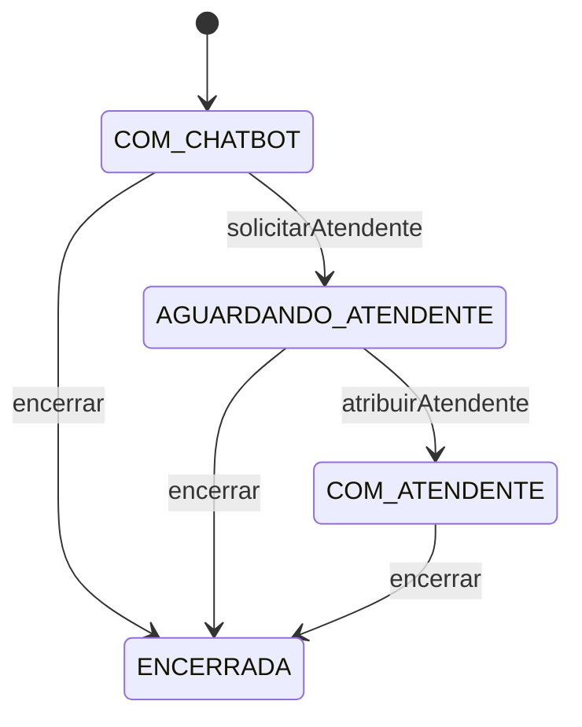

# Entrega — Semana 12 (CC): fila de conversas do chatbot

**Atividade:** implementar a persistência e as regras de negócio de "Visualizar
fila de conversas do chatbot" (classes de acesso a dados e serviços de negócio).

**Repositório:** <https://github.com/CC-2025-2-CESAR/WXN-G16>, backend em
`backend/src/main/java/br/com/wxnchatbot/backend`.

## O que foi feito

A fila de conversas é a lista de conversas em que o cliente pediu para falar com
um atendente humano e ainda ninguém assumiu. O atendente vê quem está esperando,
abre uma conversa para ler o histórico, assume o caso e, no fim, encerra.

### Persistência (classes de acesso a dados)

As entidades do domínio são mapeadas com JPA e viram tabelas no PostgreSQL:

| Entidade | Tabela | Relacionamentos |
|---|---|---|
| `Cliente` | `cliente` | uma pessoa que conversa com a Lily |
| `Atendente` | `atendente` | humano da WXN; tem a flag `disponivel` |
| `Chatbot` | `chatbot` | a Lily |
| `Conversa` | `conversa` | muitas para um `Cliente` e um `Chatbot`; opcionalmente um `Atendente` |
| `Mensagem` | `mensagem` | muitas por `Conversa`, sempre ordenadas por horário |
| `Ticket` | `ticket` | um por `Conversa` (chave única); opcionalmente um `Atendente` |

Os repositórios (Spring Data) são:

- **`ConversaRepositorio`** tem duas consultas próprias.
  - `buscarFilaAguardando()` devolve só as conversas em `AGUARDANDO_ATENDENTE`,
    já com o cliente e o ticket carregados na mesma consulta, ordenadas pelo
    ticket mais antigo (e pelo id, no empate).
  - `buscarPorIdParaAtualizar()` busca a conversa com **bloqueio pessimista**
    (`PESSIMISTIC_WRITE`), usado na hora de atribuir um atendente.
- **`AtendenteRepositorio`** é o acesso aos atendentes.

### Serviço de negócio

`FilaConversasServico` reúne as operações da fila:

| Operação | O que faz |
|---|---|
| `visualizarFila()` | lista as conversas esperando, com posição (a partir de 1), cliente, telefone, motivo e hora do pedido |
| `abrirConversaDaFila(id)` | mostra o detalhe de uma conversa da fila, com as mensagens em ordem |
| `solicitarAtendente(id, motivo)` | registra o pedido de atendimento e devolve a posição na fila |
| `atribuirAtendente(conversaId, atendenteId)` | um atendente assume a conversa |
| `encerrar(id)` | encerra a conversa e resolve o ticket |

Os dados de saída são `ConversaNaFila` e `DetalheConversaFila`. Quando algo não
existe, o serviço lança `RecursoNaoEncontradoException`.

### Regras de negócio



- **Só entra na fila** quem está em `AGUARDANDO_ATENDENTE`. Conversa com o
  chatbot, já assumida ou encerrada não aparece, e abrir o detalhe dela dá erro.
- **Ordem da fila:** quem pediu primeiro é atendido primeiro.
- **Um ticket por conversa:** pedir atendente duas vezes na mesma conversa dá erro
  e mantém o motivo original.
- **O atendente precisa estar disponível** para assumir.
- **Só uma pessoa assume cada conversa.** A busca com bloqueio garante que, se
  dois atendentes tentarem ao mesmo tempo, o segundo espere o primeiro terminar e
  então receba erro, sem tomar a conversa dele.
- **Encerrar** resolve o ticket e tira a conversa da fila. Encerrar duas vezes
  dá erro.

## Como foi testado

Foram escritos 34 testes novos, no pacote `service`:

- **21 testes unitários** do `FilaConversasServico`, com repositórios simulados
  (Mockito), que rodam em qualquer máquina, sem banco.
- **11 testes de integração** com PostgreSQL de verdade: fila ordenada, dados
  do cliente e do motivo, mensagens em ordem, conversa assumida sai da fila,
  encerramento persistido e a conversa voltando do banco completa.
- **2 testes de concorrência**, também no PostgreSQL: o segundo atendente espera
  o primeiro e não toma a conversa, e cinco atendentes tentando ao mesmo tempo
  resultam em exatamente um vencedor.

A suíte do backend inteira tem 117 testes e roda no CI de cada pull request,
com um PostgreSQL de teste. Para conferir que os testes pegam erros de verdade,
quebramos o código de propósito (tirar o bloqueio, inverter a ordem da fila,
remover o filtro de status, posição começando em zero, entre outros) e os testes
falharam em todos os casos.

Para rodar só os testes que não precisam de banco:

```bash
cd backend
./mvnw -Dtest='FilaConversasServicoTest' test
```

## Fora desta entrega

- O endpoint REST da fila e a tela do dashboard.
- A ordenação por urgência: o classificador de urgência já existe, mas ainda não
  está ligado à fila.
- Migrations versionadas (as tabelas ainda são criadas pelo Hibernate).

## Quem fez o quê

| Pessoa | Contribuição |
|---|---|
| Marcus Vinícius | `ConversaRepositorio`, `AtendenteRepositorio`, `FilaConversasServico`, `ConversaNaFila`, `DetalheConversaFila` e `RecursoNaoEncontradoException`; mapeamento JPA de `Conversa`, `Mensagem` e `Ticket` e o diagrama de classes |
| Luísa Fischer | mapeamento JPA de `Chatbot`, `Pessoa`, `Cliente` e `Atendente` |
| José Milton | classificador de urgência por regras, base para ordenar a fila por prioridade |
| Carlos Murilo | CI dos pull requests, que roda os testes do backend com PostgreSQL |
| Arthur Reis | modelo de classes do domínio (Semana 11), integração das branches, os 34 testes e este documento |
