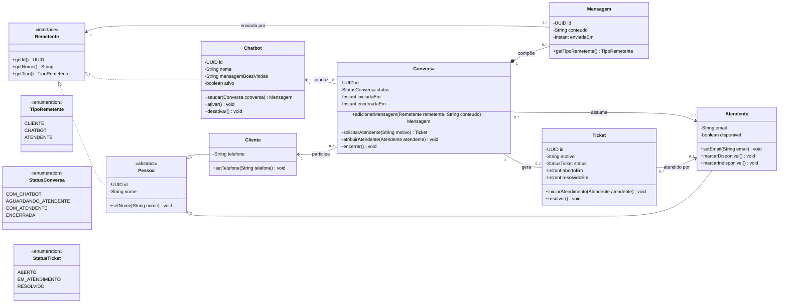
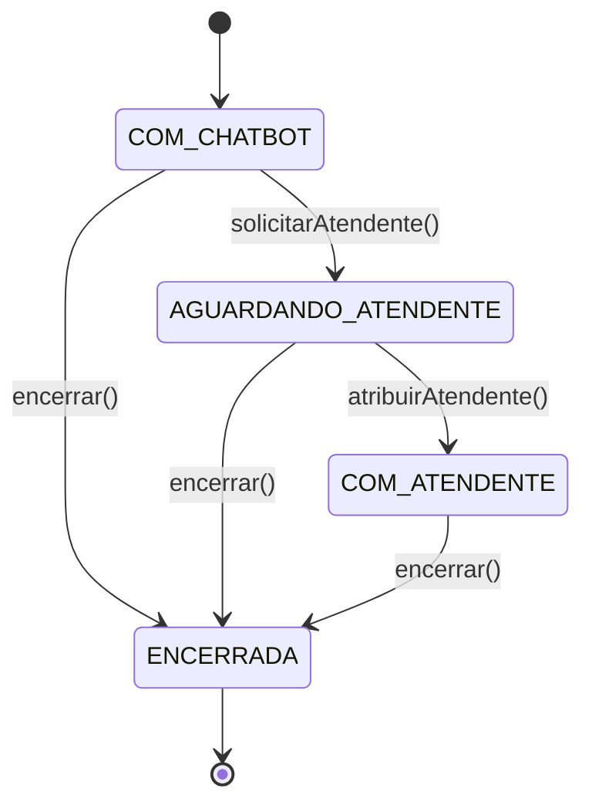

# Modelo de classes de entidade (Semana 11 — CC)

Modelagem em POO das entidades centrais da **Lily**, o chatbot de atendimento
da WXN. O código está em
[`backend/src/main/java/br/com/wxnchatbot/backend/model`](../backend/src/main/java/br/com/wxnchatbot/backend/model)
e os testes em
[`backend/src/test/java/br/com/wxnchatbot/backend/model`](../backend/src/test/java/br/com/wxnchatbot/backend/model).

São classes de domínio puras: **sem JPA, sem banco, sem Spring**. A
persistência entra depois, quando as primeiras funcionalidades forem
implementadas (ver [`modelagem-inicial.md`](modelagem-inicial.md)).

## Diagrama de classes



## Mapeamento com o pedido da atividade

| Pedido | Classe | Observação |
|---|---|---|
| Cliente | `Cliente` | Pessoa que fala com a Lily pelo WhatsApp; identificada pelo telefone |
| Atendente | `Atendente` | Humano da WXN que assume a conversa depois do handoff |
| Conversa | `Conversa` | Sessão de atendimento; guarda status, participantes e mensagens |
| Mensagem | `Mensagem` | Imutável; criada só pela `Conversa` |
| Chatbot | `Chatbot` | A **Lily**; instância configurável (nome, boas-vindas, ativa/desativada) |
| Ticket/Atendimento | `Ticket` | Registro do pedido de atendimento humano; nasce do handoff |

## Requisitos de POO aplicados

- **Atributos**: todos `private`, tipados, e `final` quando não podem mudar
  depois de criados (`id`, `cliente`, `chatbot`, `conversa`, `enviadaEm`…).
- **Encapsulamento**
  - Só existem *setters* onde faz sentido mudar o valor (`setNome`,
    `setTelefone`, `setEmail`, `setMensagemBoasVindas`), e todos revalidam.
  - Os construtores validam o estado inicial (nome obrigatório, telefone com
    10 a 15 dígitos, e-mail com `@`, mensagem não vazia).
  - `Conversa.getMensagens()` devolve uma lista **somente leitura**, então
    ninguém altera o histórico de fora.
  - O construtor de `Mensagem` e os métodos `iniciarAtendimento`/`resolver`
    de `Ticket` são *package-private*: só a `Conversa` cria mensagens e
    tickets e muda o estado deles.
  - Transições inválidas lançam `IllegalStateException`, e argumentos
    inválidos lançam `IllegalArgumentException`.
- **Herança**: `Cliente` e `Atendente` estendem a classe abstrata `Pessoa`
  (id e nome ficam num lugar só).
- **Interface e polimorfismo**: `Remetente` é implementada por `Pessoa` (e,
  por herança, `Cliente` e `Atendente`) e por `Chatbot`. Uma `Mensagem` guarda
  um `Remetente`, sem saber qual é o tipo concreto, e `Conversa` decide quem
  pode falar via `getTipo()`.
- **Relacionamentos**
  - **Associação**: `Conversa` → `Cliente`, `Chatbot` e `Atendente`;
    `Ticket` → `Atendente`.
  - **Composição**: `Conversa` ◆— `Mensagem` (a mensagem não existe fora da
    conversa).
  - **Associação 1 para 0..1**: `Conversa` — `Ticket`. O ticket só existe
    depois de `solicitarAtendente()`.

## Regras de negócio que o modelo garante

O ciclo de vida de uma `Conversa` é uma máquina de estados pequena:



- Só o **cliente da conversa** pode enviar mensagem como cliente.
- O **chatbot** não fala depois que um atendente assume.
- O **atendente** só fala se for o que assumiu a conversa.
- **Conversa encerrada** não aceita mensagem nova nem novo encerramento.
- Um **atendente indisponível** não pode assumir uma conversa.
- Um **chatbot desativado** não inicia conversa.
- Encerrar uma conversa **resolve o ticket** ligado a ela, mesmo que
  ninguém tenha assumido.

## Decisões de modelagem

- **`Ticket` é separado de `Conversa`.** A conversa é o diálogo inteiro; o
  ticket é o *pedido de atendimento humano* dentro dela. Nem toda conversa
  vira ticket (a Lily resolve sozinha boa parte), e o ticket é o que o
  dashboard vai usar para fila e tempo de atendimento.
- **`Chatbot` é uma classe, não só um tipo de mensagem.** A Lily tem
  configuração própria (boas-vindas, ativa ou não), e isso deixa a WXN trocar
  ou ter mais de um assistente no futuro.
- **`Company` (multi-tenant) ficou de fora.** Está em
  [`modelagem-inicial.md`](modelagem-inicial.md), mas não faz parte do pedido
  da Semana 11 e ainda depende de validação com a WXN.
- **`Conversa` aponta para `Cliente`, e o contrário não.** A relação é
  1 para N, mas guardar a lista de conversas dentro de `Cliente` exigiria
  manter os dois lados sincronizados. Com JPA isso vira um `@ManyToOne` na
  conversa e a lista, se for preciso, sai de uma consulta.
- **O `id` é um `UUID` gerado na criação.** Quando entrar o banco, a decisão
  de manter o UUID ou trocar por um id gerado pelo banco é revista junto com
  as migrations.
- **A IA não está no modelo.** `Chatbot.saudar()` só registra uma mensagem; a
  geração de respostas vem depois, em cima desta base.

## Como rodar os testes

Os testes do domínio são JUnit puro (sem banco). Na pasta `backend/`, com
JDK 21:

```bash
./mvnw -Dtest='br.com.wxnchatbot.backend.model.*Test' -Dsurefire.failIfNoSpecifiedTests=false test
```

(O `BackendApplicationTests` da fundação carrega o contexto do Spring e
precisa do PostgreSQL configurado, por isso é filtrado aqui.)
